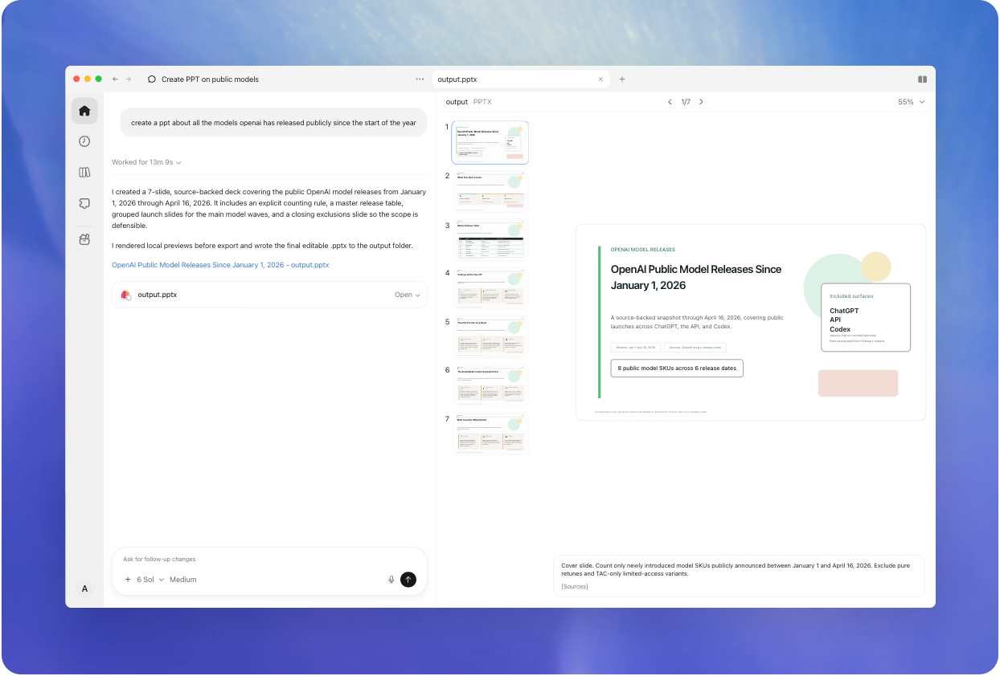
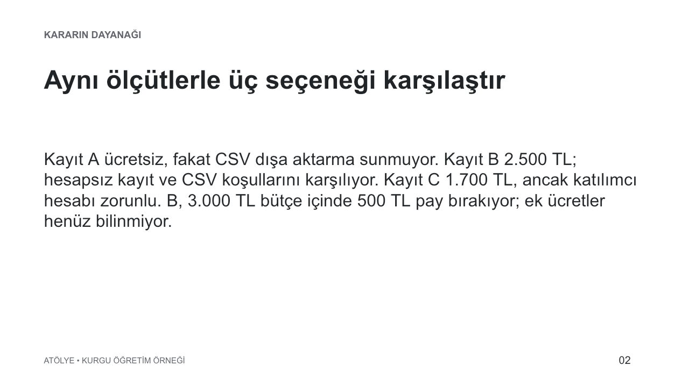
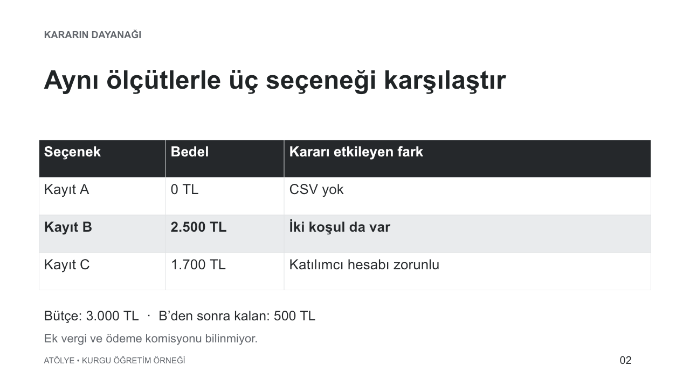

# Araştırmadan karar ve sunuma

İçerik güncellemesi: 2026-10-31. Kaynak kontrol tarihleri kaynak dizinindedir.

**Kurgu iş:** Atölye, 60 kişilik ücretsiz Tanışma Buluşması için kayıt sistemi seçecek. Katılımcıya hesap açtırmak istemiyor; katılımcı listesini CSV olarak indirebilmesi gerekiyor. Etkinlik başına bütçe 3.000 TL. Aşağıdaki platform adları, fiyatlar ve belge parçaları eğitim için uyduruldu. Gerçek bir ürün karşılaştırması veya yapılmış satın alma yok.

Bu işin sonunda iki şey görünmeli: seçimin dayanağı olan kısa karar notu ve aynı kararı anlatan düzenlenebilir sunum. Araştırma, taslak ve görsel düzeltme tek bir iş içinde birbirini besliyor.

**Karar bilgisini biçimler arasında koru**

1. **Girdi:** Ölçüt + kaynak paketi
2. **Seçim:** Zorunlu koşulla ele
3. **Karar:** Gerekçeyi ve sınırı yaz
4. **Çıktı:** Aynı bilgiden sunum

## Atölye’nin iki işi

Atölye bu rehberin kurgu öğrenme topluluğu. **Tanışma Buluşması**, 14 Kasım 2026’da yapılan, 60 kişilik ücretsiz etkinlik; kayıt sistemi ve web sayfası bunun için hazırlanıyor. **Uygulama Programı** ise ayrı, ücretli bir çalışma; tahsilat örneğindeki altı kayıt bu programa ait. Altı satır, 60 kişilik buluşmanın katılımcı listesinin tamamı veya örneklemi değil. Sonraki hafta yeni kayıtlar aynı ücretli programın raporuna gelir.

Tarih değişikliği ve bütçe denemeleri açıkça kurgu devam diye işaretlenir; önceki kaynak kendiliğinden değişmiş sayılmaz. Bu ayrım, bir topluluğun farklı işleri arasında bilgiyi yanlışlıkla taşımamayı da öğretir.

## Henüz ne isteyeceğini bilmiyorsan

İlk cümlen yalnız “Atölye için kayıt sistemi lazım” olabilir. Ölçütleri tek başına bulmak zorunda değilsin. Codex’ten kararını şekillendiren kısa bir görüşme iste; resmî rehber de belirsiz fikri sorularla somutlaştırmayı öneriyor. [Planlama ve sorular](https://learn.chatgpt.com/docs/learn/best-practices)

> Önce mevcut notları oku. Kararı değiştirecek en fazla üç eksik bilgiyi sor; her soruda seçenekleri ve önerini açıkla. Kaynaklarda cevabı olanı tekrar sorma. Henüz hizmet seçme veya hesap açma.

**Kurgu konuşma:** Notlarda yalnız ücretsiz Tanışma Buluşması’nın adı var. Anlatıcı şu üç soru–cevabı gösterir:

| Codex’in ayırıcı sorusu | Kullanıcının cevabı | Karara etkisi |
|---|---|---|
| Kaç kişi ve hizmet için ne kadar bütçe? Tahmini aralık da başlangıç olabilir. | 60 kişi, etkinlik başına en fazla 3.000 TL. | Kapasite ve maliyet sınırı belirlenir. |
| Katılımcı hesabı zorunlu olabilir mi? Giriş engelini azaltmak istiyorsan hesapsız kayıt öneririm. | Hesap açtırmayalım. | Bu koşulu karşılamayan seçenek elenir. |
| Kayıtlar sonra nerede kullanılacak? Tabloya aktaracaksan CSV dışa aktarmayı koşul yapalım. | Listeyi kendi tablomda kullanacağım. | CSV zorunlu olur. |

Çıkan kısa görev: “60 kişi, hesapsız kayıt, CSV ve 3.000 TL sınırıyla seçenekleri karşılaştır.” Bu bir zorunlu soru formu değil; cevapları zaten biliyorsan doğrudan aşağıdaki isteğe geç. Teknik kurulum ayrıntılarını kullanıcıya soru diye geri yüklemek bu görüşmenin amacı değildir.

## 1. İstekten önce kararın ölçüsünü kur

“En iyi platformu bul” demek araştırmanın nereye kadar süreceğini açık bırakır. Bu işte kaliteyi üç koşul belirliyor: hesapsız kayıt, CSV dışa aktarma ve bütçe. Renk veya yüzlerce entegrasyon ancak bu koşulları sağlayan seçenekler arasında fark yaratıyorsa önemli.

> Atölye'nin 60 kişilik etkinliği için kayıt sistemi seçiyoruz. Hesapsız kayıt ve CSV dışa aktarma zorunlu; bütçe etkinlik başına 3.000 TL. Önce bu ölçütlerle bir karşılaştırma çıkar, sonra tek öneri ve öneriyi değiştirecek koşulu yaz. Henüz hesap açma veya satın alma yapma.

İş belirsizse `/plan` ile ölçütleri birlikte netleştirebilirsin. Burada ölçütler zaten belli olduğundan doğrudan uygulama isteği yeterli. Bir planın varlığı ayrıca karar kalitesini garanti etmez. [Plan komutu](https://learn.chatgpt.com/docs/reference/slash-commands)

## 2. Kaynak yığınını karşılaştırılabilir kanıta dönüştür

Anlatıcı [kurgu kaynak paketini](ornekler/arastirma-kaynaklari.md) açar. Üç kısa belge parçası şöyle bir karşılaştırmayı destekliyor:

| Kurgu seçenek | Etkinlik bedeli | Hesapsız kayıt | CSV | İlk karar |
|---|---|---|---|---|
| Kayıt A | 0 TL | Var | Yok | Zorunlu dışa aktarma koşulunu karşılamıyor |
| Kayıt B | 2.500 TL | Var | Var | Üç koşulu da sağlıyor |
| Kayıt C | 1.700 TL | Yok | Var | Katılımcı hesabı zorunlu |

Gerçek işte bu tabloyu güncel resmî sayfalarla kurdur. Kaynak URL'sini, okunan koşulu ve kontrol tarihini birlikte tut. “CSV var” ifadesinin seçtiğin pakete mi, daha pahalı bir pakete mi ait olduğunu sor. Açılmayan sayfayı tahminle tamamlama. Araştırma yolu seçimi [web ve tarayıcı bölümünde](09-web-tarayici-bilgisayar.md).

**Kurgu ara hata:** İlk taslak C'yi en ucuz ücretli seçenek olduğu için öneriyor. Sorun yetersiz yaratıcılık veya düşük düşünme seviyesi değil; zorunlu koşulun sıralamaya katılmaması.

> C daha ucuz, fakat katılımcıya hesap açtırmama koşulunu karşılamıyor. Zorunlu koşulları önce eleme ölçütü yap. Uygun seçenekler arasında maliyeti karşılaştır. Kaynak paketini değiştirme.

Bu düzeltme bir sıfatı değiştirmiyor, karar yöntemini düzeltiyor. B'nin bütçenin altında kalan payı 500 TL; bu sayının rahatlık payı mı yoksa başka masraflara yetecek bütçe mi olduğu ayrı bir değerlendirme. Örnekte ek vergi veya ödeme komisyonu bilgisi yok; toplam maliyetin bunları içerdiği varsayılmıyor.

### Sıradaki araştırmayı kararı değiştirecek boşluğa ver

B’nin 500 TL bütçe payını aşan bir ek ücret seçimi değiştirebilir; logosunun rengi değiştirmez.

> Önce B’nin ek ücretinin bütçeyi aşıp aşmadığını araştır. Yeni özellik listesi toplama. Bilgi bulunamazsa öneriyi koşullu bırak ve gereken soruyu yaz.

Anlatıcı burada [üç bağlantının neden tek dayanak olabileceğini gösterir](09-web-tarayici-bilgisayar.md#cok-baglanti-kac-bagimsiz-dayanak). Bu kurgu pakette ek ücret yanıtı yoktur. Dolayısıyla sonuç “kesin satın al” değil, koşullu öneridir. Daha fazla aramanın hangi kararı değiştireceği belli olduğunda araştırma sınır kazanır.

## 3. Seçimi tek cümleye sığdır, gerekçeyi kaybetme

İyi karar notu bütün araştırmayı tekrar anlatmaz. [Örnek karar notunda](ornekler/karar-notu.md) öneri, gerekçe, elenen seçenekler ve açık koşul birlikte duruyor:

> Kurgu belgelerdeki koşullara göre Kayıt B öneriliyor: hesapsız kayıt ve CSV gereksinimlerini karşılıyor, listelenen 2.500 TL bedel bütçenin altında. Ek ücretler doğrulanmalı. Hesap açma koşulu kabul edilirse C yeniden değerlendirilebilir.

Öneriyi değiştirecek koşulu yazmak, kararın hangi varsayıma dayandığını görünür yapar. Kullanıcı daha sonra “hesap açmak sorun değilmiş” derse bütün araştırmayı baştan yapmak gerekmez; değişen ölçütle sıralama yenilenir.

Aktarım zincirindeki gerçek karşılık için [C02 vakasına](deneyimler.md#c02) bakabilirsin.

## 4. Doğrulanmış nottan yeni biçimler üret

> Bu karar notunu ana kaynak kabul et. Karar, dayanak ve açık koşulu taşıyan üç slaytlık sunum taslağı hazırla. Yeni fiyat veya özellik ekleme. Ayrıca aynı kararı 100 kelimeyi geçmeyen ekip duyurusuna dönüştür.

**Aynı kaynaktan kısa ekip duyurusu — kurgu çıktı:**

> Atölye kaydı için B’yi koşullu olarak öneriyoruz. Hesap açmadan kayıt ve CSV dışa aktarma gereksinimlerini karşılıyor. 2.500 TL fiyat, 3.000 TL bütçe içinde 500 TL pay bırakıyor. Ek vergi ve ödeme komisyonu henüz bilinmiyor; toplam maliyeti doğrulamadan satın alma kararı vermeyeceğiz.

Karar notu gerekçeyi ayrıntılandırır, slayt karşılaştırmayı gösterir, duyuru ekibin bilmesi gereken kararı özetler. Üçünde de belirsizlik korunur.

Anlatıcı [düzenlenebilir üç slaytlık sunumu](ornekler/atolye-karar.pptx) açar. Fiyat hücresini değiştirebilmek ile slaytın yalnız resmini almak arasındaki teslim farkı [dosya biçimi bölümünde](17-teslim-yayin.md#uzanti-degil-yapabilecegin-degisiklik) gösteriliyor. [Metin taslağı](ornekler/sunum-taslagi.md) aynı kararın sade kaynak karşılığıdır. Aynı B önerisi, aynı 2.500 TL ve aynı ek ücret belirsizliği korunuyor. Slayt için daha kısa yazılması, “ek ücretler bilinmiyor” cümlesinin silinmesini haklı çıkarmaz.

**Sohbetin yanında sunum önizlemesi.** Solda üretim isteği ve dosya bağlantısı, sağda slayt listesi ve seçili slayt var. Dosyayı yalnız teslim mesajından değerlendirmek yerine önizlemede incele. [Tam boyut](assets/preview.png) · OpenAI’nin resmî arayüz gösterimi · [Kaynak](https://learn.chatgpt.com/docs/artifacts-viewer) · 2026-10-29.

1. **Nereye bak:** Soldaki output.pptx bağlantısına, sağdaki slayt listesine.
2. **Ne yap:** Sorunlu slaytı seç; yalnız o parçanın değişmesini, sayıların korunmasını iste.
3. **Ne gör:** Son dosyada aynı karar ve verilerle daha okunur bir slayt.

Resmî görselde farklı bir sunum gösteriliyor; Atölye için çalıştırılmış oturum ekranı değil. Buradan öğrenilecek hareket, üretim mesajından dosyanın önizlemesine geçmek. Bir slayt kalabalıksa bütün sunumu yeniden yazdırmadan “yalnız ikinci slaytı sadeleştir; karar, sayı ve kaynakları koru” diye belirt. Desteklenen önizlemelerde işaretlenen alan bağlam olarak gönderilebilir. [Dosya önizleme ve yorum](https://learn.chatgpt.com/docs/artifacts-viewer)

### Aynı ikinci slaytı sadeleştir

Aşağıdaki iki görüntü, bu rehber için gerçekten oluşturulan PowerPoint örneğinden render edildi. Yoğun sürüm tek paragrafta A/B/C’yi anlatıyor; son sürüm aynı bilgiyi üç karşılaştırma satırına ayırıyor.

**Aynı ikinci slayt: paragraf hâlindeki ilk sonuç.** Üç seçeneğin bedel ve koşulları bir paragrafta; karşılaştırmak için metni tekrar taramak gerekiyor. [Tam boyut](assets/atolye-slayt-once.png) · Kurgu veriden üretilmiş gerçek çıktı · [Kaynak](ornekler/atolye-karar.pptx) · 2026-10-31.

1. **Nereye bak?:** A, B ve C bilgileri aynı paragrafta.
2. **Ne yap?:** Yeni araştırma istemeden aynı bilgiyi karşılaştırma tablosuna dönüştür.
3. **Ne gör?:** Düzeltme bilgi miktarını değil kararın görünürlüğünü değiştirir.

> Yalnız ikinci slaytı sadeleştir. A’nın CSV eksiği, B’nin 2.500 TL bedeli ve C’nin hesap koşulu kalsın. Diğer slaytları değiştirme.

**Aynı ikinci slayt: karşılaştırılabilir sonuç.** Düzenlenebilir sunumdaki tablo seçenekleri aynı ölçütlerde toplar; bütçe payı ve bilinmeyen ek ücret korunur. [Tam boyut](assets/atolye-slayt-2.png) · Kurgu veriden üretilmiş gerçek çıktı · [Kaynak](ornekler/atolye-karar.pptx) · 2026-10-31.

1. **Nereye bak?:** B satırındaki koşul ve 2.500 TL bedeli birlikte oku.
2. **Ne yap?:** Yalnız ikinci slaytı düzelt; karar notunu ve diğer slaytları koru.
3. **Ne gör?:** 500 TL pay, bilinmeyen ek ücret için araştırma sınırını gösterir.

[Birinci slayt](ornekler/atolye-slayt-1.png) kararı, [üçüncü slayt](ornekler/atolye-slayt-3.png) açık koşulu gösterir. “Sadeleştir” isteği bilginin silinmesi anlamına gelmedi. Resmî önizleme görseli uygulamadaki açma hareketini; bu iki görüntü ise bizim örneğimizin gerçek çıktısını gösterir.

## 5. İşin bittiğini hangi çıktıda görürsün?

Teslim, [karar notu](ornekler/karar-notu.md) ve [düzenlenebilir sunumdur](ornekler/atolye-karar.pptx). Slaytlar gerçek dosyadan üretilip açılarak incelendi; fiyat ve platformlar kurgu. Satın alma veya duyuru gönderimi yapılmadı.

Aynı bilgiyi başka biçime taşırken kararı, tutarı ve belirsizliği koru. Sonraki iş bu yaklaşımı [sayısal veriye](is-veri.md) taşır.

**Eğitimde sıradaki:** [Dağınık tablodan güvenilir rapora](is-veri.md)

[İçindekiler](README.md)
