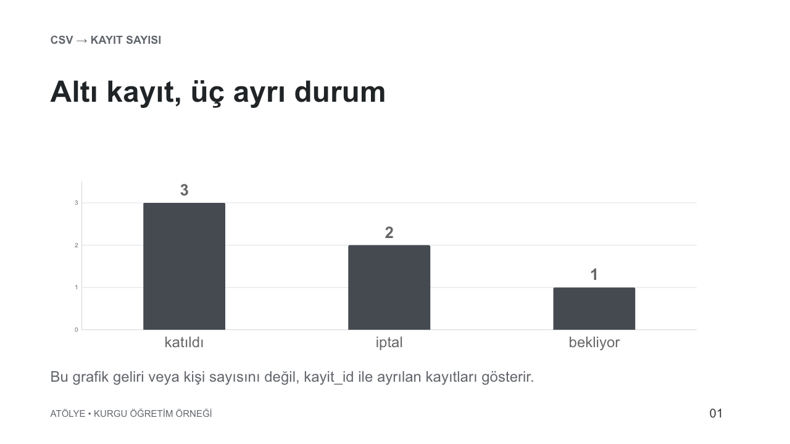

# Dağınık tablodan güvenilir rapora

İçerik güncellemesi: 2026-10-31. Kaynak kontrol tarihleri kaynak dizinindedir.

**Kurgu iş:** Atölye'nin etkinlik kayıtları farklı biçimlerde tutulmuş. Altı kayıt var; iki kişinin adı aynı, bir tahsilat boş. Amaç, kimseyi kaybetmeden düzenli tablo ve kısa rapor üretmek. İsimler ve tutarlar eğitim için kurgulandı. Dosyalar gerçek katılımcı verisi içermiyor.

Anlatıcı [ham CSV'yi](ornekler/katilim-ham.csv) ve [beklenen temiz çıktıyı](ornekler/katilim-temiz.csv) yan yana açabilir. CSV, satır ve sütunlardan oluşan, birçok tablo uygulamasında açılabilen düz metin biçimidir. Hesap için görüntü yerine bu girdiyi seçmenin nedeni [girdi karşılaştırmasında](02-uygulama.md#ayni-bilgi-farkli-girdi-hangisini-vermeli) açıklanıyor. Bu dosyalar bir oturumun otomatik kaydı değil, yöntemi incelemek için hazırlanmış örnek girdiler ve çıktılardır.

**Dönüşüm boyunca kayıt kimliğini izle**

1. **Girdi:** 6 kimlikli ham kayıt
2. **Kural:** Biçimi düzelt, anlamı koru
3. **Kontrol:** Eksik tutarı ayrı göster
4. **Çıktı:** CSV + kaynakla tutarlı rapor

## 1. Güzel tablo yerine korunacak bilgiyi tarif et

“Veriyi temizle” isteğinde hangi değişikliklerin kabul edilebilir olduğu belirsizdir. Aynı isimli iki kişiyi birleştirmek tabloyu kısaltır ama bilgiyi kaybettirir. Eksik ödemeyi sıfır yapmak da hiç tahsilat yapılmadığı iddiası üretir.

> Ham dosyayı koru. Kimlik alanı kayit_id olsun; aynı isimleri birleştirme. Tahsilatları sayıya dönüştür, boş tutarı boş bırak. Durumları değiştirmeden temiz CSV ve kısa rapor üret. Kaynak ve sonucu kimlik bazında eşleştir.

Burada karar yetkisini işin niteliğine göre dağıtıyorsun: sayı biçimini dönüştürmeye izin var; eksik ödeme gerçeğini icat etmeye yok. Her satır için soru sormak yerine belirsiz kayıtları tek listede raporlamasını isteyebilirsin.

## 2. Zor örneklerde yöntemi görünür yap

Anlatıcı bütün tabloyu okumak yerine üç ayırıcı durumu gösterir:

| Kayıt | Ham bilgi | Doğru yorum | Yanlış kestirme |
|---|---|---|---|
| K02 | Deniz; katıldı; 600,00 | Tahsilat 600; kimlik K02 | İsmi aynı diye K03 ile birleştirmek |
| K03 | Deniz; iptal; 0 | Ayrı kişi/kayıt; tahsilat sıfır | K02'nin durumuyla üzerine yazmak |
| K04 | Ece; katıldı; tutar boş | Katılım biliniyor, tahsilat bilinmiyor | Boşluğu 0 veya 600 ile doldurmak |

İlk dönüşümü bu ayrımlarda gör. Kural doğruysa tüm tabloya uygulat. Anlatıcının üç satırı göstermesiyle altı kaydın tamamının kontrol edilmesini [inceleme kapsamında](03-calisma-mantigi.md#ne-kadarini-inceledigini-gor) ayrı tut. Kesin ve tekrarlanacak dönüşümde aynı kuralları küçük bir betiğe taşımak yararlı olabilir; her hafta aynı altı kararı yeniden yorumlatmak gerekmez. Betik, programın bir dizi işlemi tekrarlanabilir biçimde yürütmesidir.

## 3. Sonucun ne söylediğini sınırlarıyla oku

[Örnek raporda](ornekler/katilim-raporu.md) dört sonuç var:

| Ölçü | Kurgu veriden çıkan sonuç | Anlamı |
|---|---|---|
| Kayıt sayısı | 6 | Altı farklı kayit_id korundu |
| Durum dağılımı | 3 katıldı, 2 iptal, 1 bekliyor | Katılım durumu toplam altı kayda karşılık geliyor |
| Bilinen tahsilat | 1.800 TL | Boş K04 tutarı hariç, verilen tutarların toplamı |
| Tahsilatı bilinmeyen | 1 kayıt: K04 | Tam tahsilat toplamı henüz bilinmiyor |

K05 bekliyor durumunda ama 600 TL tahsilat kaydı var. “Katılan kişi sayısı × bilet bedeli” ile tahsilat toplamı bu nedenle aynı hesap değildir. Hangi soruyu cevapladığını seçmeden grafik çizdirmek yanlış sonuç verebilir.

**Kurgu ara hata:** Rapor “toplam gelir 1.800 TL” diyor. Hesap verilen sayılar için doğru olsa da ifade bütün gelirin bilindiğini düşündürüyor.

> 1.800 TL'yi bilinen tahsilat olarak adlandır. K04 için tutar bilinmediğini aynı yerde göster. Eksik tutara varsayılan değer koyma. Katılım ve ödeme dağılımlarını ayrı anlat.

Bu müdahale rakamın temsil ettiği şeyi düzeltiyor.

## 4. Grafiği cevabı belli soruya çizdir

> Katılım durumunu üç kategoriyle göster. Tahsilatı ayrı tabloda tut; eksik tutarı dipnotta gizleme. Grafiğin yanında sayıları düz metin olarak da ver.

Burada durum dağılımını anlatan basit bir çubuk grafik yeterli olabilir. Tahsilat için etkileşimli gösterge paneli kurmaya gerek yok. Bir sonraki toplantıda fiyat değişimini tartışacaksan, o zaman ayrı bir kurgu bütçe görselleştirmesi yararlı olur. Gerçek kayıt ile varsayımsal bütçeyi aynı grafikte karıştırma. [Görselleştirme seçimi](13-tasarim.md#kavram-anlatmak-icin-etkilesimli-gorsellestirme)

Tablo programında sonucu açıp kontrol edebilirsin. Desteklenen masaüstü önizlemesi kaynak ve çıktıyı inceleme akışına yardımcı olur; kullanılan dosya türüne göre özellikler değişir. [Dosyalarla çalışma](https://learn.chatgpt.com/docs/artifacts-viewer)

**Altı kaydın durum dağılımı.** Ham CSV’den sayılan 3 katıldı, 2 iptal, 1 bekliyor kaydı. Çubuklar aynı sıfır tabanında 3:2:1 oranındadır. [Tam boyut](assets/katilim-grafik.png) · Kurgu veriden üretilmiş gerçek çıktı · [Kaynak](ornekler/katilim-grafik.csv) · 2026-10-31.

1. **Nereye bak?:** Çubuk etiketleri ve ortak sıfır tabanı.
2. **Ne yap?:** Dağılımı kayit_id bazındaki altı kayıtla karşılaştır.
3. **Ne gör?:** Katılım durumu tahsilat toplamını söylemez; K04’ün boş tutarı bu grafikte gizlice doldurulmaz.

Grafik, [ham CSV’den](ornekler/katilim-ham.csv) sayılar hesaplanarak gerçekten üretildi. Üç çubuğun değerleri 3, 2 ve 1; toplam altı kayıt. Tahsilat ayrı kaldı. “1.800 TL gelir” başlıklı aynı grafiği üretmek bu sorunun cevabı olmazdı. [Grafiğin veri tablosu](ornekler/katilim-grafik.csv).

Anlatıcı önce grafiği, sonra K05 satırını gösterir: bekleyen kişinin tahsilatı olabilir. Böylece katılım dağılımıyla ödeme toplamının neden ayrı ölçüler olduğu görünür.

## 5. İş tekrarlanacaksa önce sabit kalan kısmı ayır

Bir kez çalışan rapordan hemen otomasyon kurmak yerine yöntemi sonraki gerçek dosyada da kontrol et. Yeni bir durum etiketi veya farklı sayı biçimi gelirse betik bunu sessizce yanlış dönüştürmesin; belirsiz satır olarak ayırsın. Rapor her çalıştırıldığında aynı haftaya ikinci kopya üretmek yerine aynı hedefi güncelleme kuralı belirle.

Kurallar yerleştiğinde otomasyona şu işi ver: “Belirlenen klasördeki yeni kayıt dosyasını bu yöntemle işle, raporu kaydet; yeni durum etiketi veya eksik veri varsa bana bildir.” Kullanıcıya mesaj gönderme ya da dış sisteme yayın yapma bu isteğin kendiliğinden parçası olmaz. [Tekrar eden işler](15-otomasyon.md)

**Teslim:** Kaynak korunmuş, temiz CSV açılabilir, kimlik eşlemesi tamam, eksik tutar görünür ve rapordaki dört sonuç kaynakla tutarlı. Gerçek işte XLSX gerekiyorsa hesaplamaları ve düzenlenebilirliği o dosyada ayrıca kontrol et.

**Başka işte kullanacağın ders:** Kimliği koru, bilinmeyeni sıfıra çevirme, ölçünün neyi temsil ettiğini yaz. Bu üç karar müşteri listesi, stok, anket veya bütçe dosyasında da yararlıdır. Sonraki örnekte aynı netlik görsel bir düzeltmeye uygulanıyor: [sayfadan doğrulanmış yayına](is-sayfa.md).

Bu sonucu grafiğe taşırken sayıları [veriden çizdirme yöntemini](13-tasarim.md#sayisal-grafik-bir-resimden-daha-fazla-dogruluk-ister), aynı hatanın dönmesini önlemek için [kontrol kartını](18-iyilestirmek.md#duzeltmeni-kucuk-bir-kabul-ornegine-donustur) kullanabilirsin.

İkinci girdide yöntemin ne yaptığını [skill gösteriminde](10-baglantilar-skills.md#yontem-ikinci-haftada-neyi-koruyor) görebilirsin.

**Eğitimde sıradaki:** [Görsel sorundan doğrulanmış yayına](is-sayfa.md)

[İçindekiler](README.md) · [← Araştırmadan karar ve sunuma](is-arastirma.md) · [Görsel sorundan doğrulanmış yayına →](is-sayfa.md)
